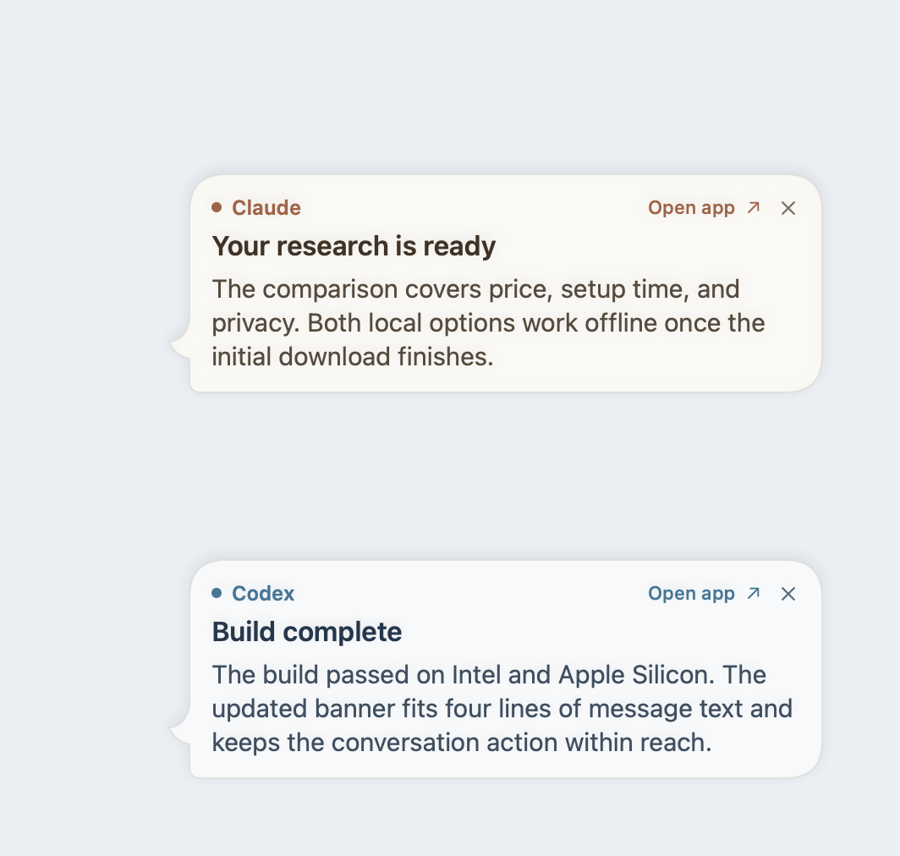
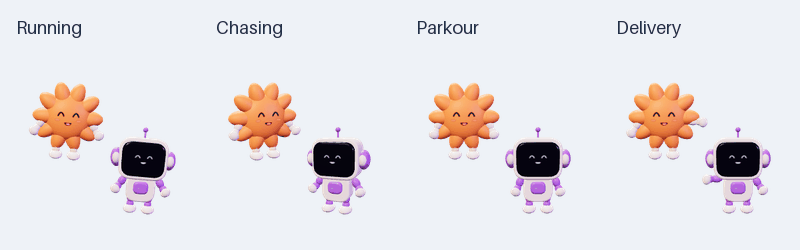
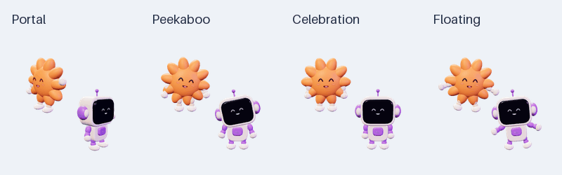
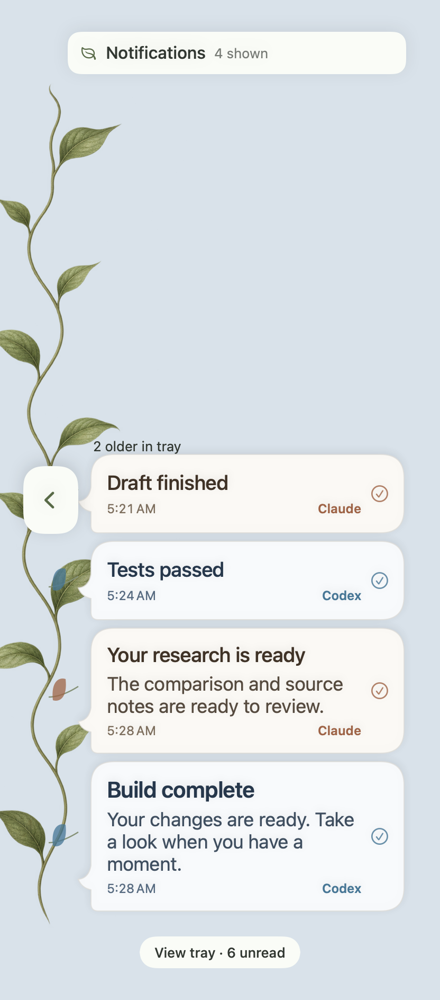
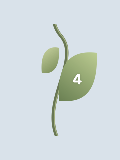
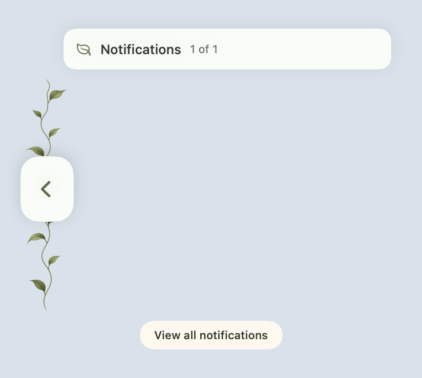
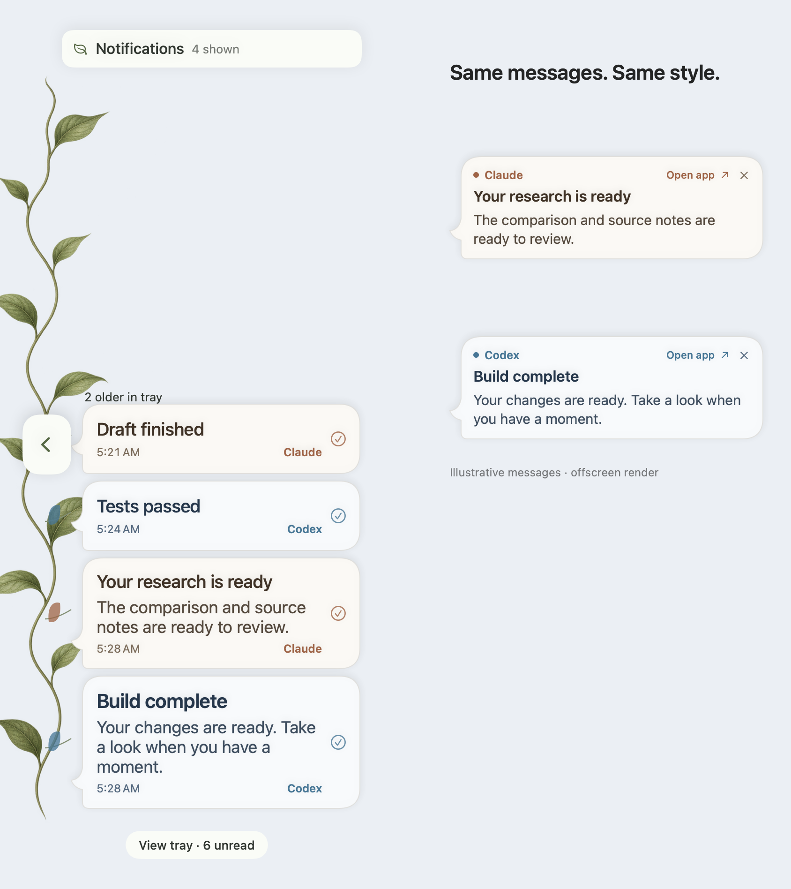
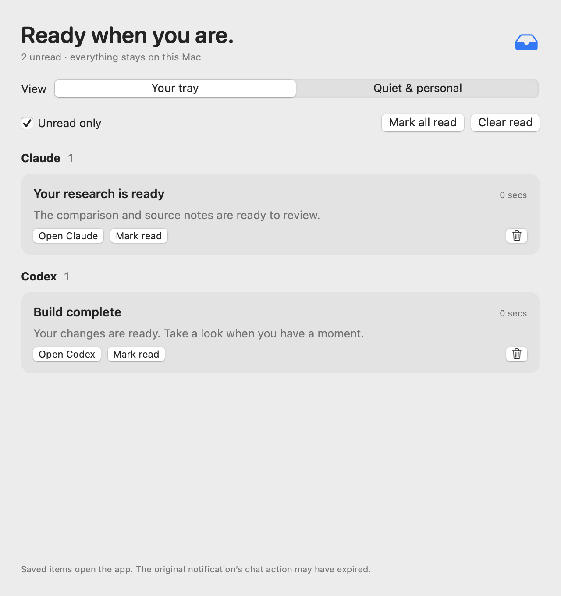
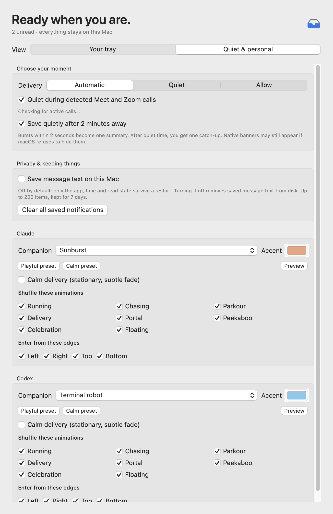

# Psst

Little messengers for your Mac notifications.

Psst turns Claude and Codex desktop notifications into animated companions and speech bubbles. Claude gets a warm sunburst; Codex gets a terminal robot and a blue bubble. All eight entrances rotate in a shuffled order, starting at random points along the screen edges.

## A little personality, without losing the message



Actual app views rendered offscreen with illustrative messages. No desktop recording.

### All eight animations





These GIFs show the bundled character frames. In the app, companions also travel from random points along your selected screen edges; the message stays readable in its corner. All eight styles and all four edges are enabled by default.

### A vine for pending notifications



Unread Claude and Codex updates become orange and blue leaves along the left screen edge. Click a title to open its app or the check to mark it read. The vine uses the full available screen height and shows up to two unread previews per app in a single timeline anchored at the bottom, newest last, with their titles and message previews. Items without saved text are omitted from the vine; all notifications remain in the full tray. New cards fade in, with a static Reduce Motion alternative. Collapse it with the larger button midway down the left edge, or hide it through **sparkle menu → Hide notification vine**. Use **Open notification vine** to bring it back. It collapses after 20 seconds with the pointer away. Choose **Vine only for 30 minutes** to keep saving incoming alerts while pausing Psst’s popup bubbles. Quiet mode and an empty tray default to the small leaf badge; clicking it still opens the vine. The vine and live alerts share speech-bubble styling, including light/dark colors and blue Codex accents.





The fade preview uses illustrative content rendered offscreen; it is not a desktop recording.



### Catch up when you’re ready



Missed notifications stay in your tray. Bursts within two seconds become one summary. Quiet mode holds deliveries until you’re ready, then offers one catch-up.

<details>
<summary>See quiet mode and personalization settings</summary>



</details>

## Download and install

Get **Psst-0.8.8-universal.dmg** from [Releases](https://github.com/Sickaada/psst/releases). Apple Silicon and Intel are included in one app. macOS 14 or newer is required. Notification compatibility depends on the macOS and source-app versions; this first release has not been tested on every supported Mac.

1. Open the disk image and drag **Psst** into **Applications**. Eject the disk image.
2. Open Psst from Applications. This personal/community build is locally signed, **not Apple-notarized**. If macOS blocks it, review [Apple’s instructions for opening an app from an unidentified developer](https://support.apple.com/en-us/102445). Only proceed if you trust this download. Do not disable Gatekeeper globally or install a signing certificate.
3. Click **Connect**, then enable Psst in **System Settings → Privacy & Security → Accessibility**. Quit and reopen Psst if the connection does not refresh.
4. Keep notifications and banners enabled for Claude/Codex in macOS settings. Focus modes may suppress banners, which Psst cannot capture.
5. Use **Preview** to check the characters, then trigger a real notification while Claude/Codex is in the background.
6. Optional: add **Psst** under **System Settings → General → Login Items → Open at Login**. The sparkle menu provides settings and Quit.

A ZIP version is also available if you prefer to unzip and move `Psst.app` into Applications. No Python, Node, Xcode, API key, or subscription is required to use the downloaded app.

## What it does

- A local notification tray with unread counts, mark-read and remove controls; up to 200 items for seven days.
- Automatic quiet delivery after two minutes idle and best-effort Meet/Zoom call detection, plus manual Quiet/Allow overrides.
- Per-app companion, accent, allowed styles and entrance edges; calm/playful presets.
- Eight styles: running, chasing, parkour, delivery, portal, peekaboo, celebration, floating.
- Every style appears before the shuffle refills; no immediate repeats at cycle boundaries.
- Random entrance points on all four edges of the main display’s visible area. The message stays in your chosen corner.
- Hover pauses dismissal. Close dismisses the card and its companion.
- **Open chat** invokes the original notification’s Open action when it remains available. If the notification expired or macOS does not expose that action, Psst opens the app instead. Chat routing depends on the source app; it is not guaranteed for every notification.
- If a notification matches the foreground Claude/Codex chat’s exposed window or selected-tab title, Psst marks it read and skips its leaf/animation. Opening a matching chat later also clears pending alerts. Merely running the app or having a background tab open does not count. Generic or unavailable chat titles keep the notification unread; this is best-effort native-app matching, not guaranteed chat identification.
- Reduce Motion uses a stationary character and fade.
- Optional message-text hiding and experimental original-banner suppression.

## Privacy and limitations

Psst reads visible Notification Center banners through Accessibility. It does not record your screen, read your chat history, request notification APIs from Claude/Codex, or send data to a server. By default notification text stays in memory; only app, time and read state persist in the SQLite database at `~/Library/Application Support/Psst/notifications.sqlite`. You can opt into saving message text locally; saved previews then survive restarts. Existing JSON history migrates automatically. Turning that option off removes saved text from disk. Diagnostics never include message text. Preferences stay on your Mac. Focus matching reads only the foreground supported app’s focused-window and selected-tab labels; these labels are neither logged nor persisted.

Meeting detection inspects Accessibility labels in supported browsers and Zoom for active leave/end-call controls. It does not use screen recording, microphone recording or a calendar account. It is a heuristic: hidden tabs, non-English controls and app updates may prevent detection. Manual Quiet mode remains available. A detected call stays quiet for 60 seconds after its controls disappear. This release has not yet been verified in a real Meet/Zoom call. Saved tray items open the source app; they cannot reliably recover an expired chat-specific notification action.

Diagnostics contain event names, counters, source-app names, timing and runtime status in `~/Library/Logs/Psst/`. Notification Center’s Accessibility structure is not a stable public integration contract, so macOS updates can affect capture. Standard macOS banners must stay enabled. Reply buttons and other original notification actions are not reproduced.

This is an independent community app, not affiliated with Anthropic or OpenAI. The bundle identifier remains `local.alienping.mac` to retain existing users’ preferences and Accessibility identity after the rename.

## Build from source

Requires Xcode Command Line Tools / Swift 5.9+ and Python 3. No third-party Swift packages.

```sh
swift run --package-path . AlienCoreTests
python3 scripts/test_pipeline.py
python3 scripts/test_signing.py
python3 scripts/validate_sprites.py
```

To make your own persistent local signing identity (one-time, macOS Keychain may ask for approval):

```sh
python3 scripts/setup_signing.py
./build.sh
```

The output defaults to `../Psst.app`; set `APP_OUTPUT` to choose another path. The private signing key stays in your Keychain; never commit/export it to this repository. `scripts/sign_app.py` pins the certificate and bundle identifier and fails if no valid signing configuration exists. It does not silently fall back to ad-hoc signing. Our release signing identity is not included. Your own builds require your own initial Accessibility approval.

`./pipeline.sh update` is the legacy developer checkout updater. It uses `../AlienPing.app`, takes a backup, verifies signatures, checks a fresh runtime heartbeat, and starts quietly without opening settings or sending test notifications. Synthetic notifications are only sent when explicitly requested with `--preview`. It does not overwrite `/Applications/Psst.app`. `./pipeline.sh rollback` restores its previous local build and re-signs it with the configured identity.

For a distributable release, run `python3 scripts/package_release.py /path/to/Psst.app /path/to/output`. Apple Developer ID signing and notarization are required for normal trusted public distribution; this repository does not claim notarization.

## License

MIT for code and original procedural companion artwork. The bundled legacy arrival-effect atlas is CC0; see [asset attribution](Resources/Mascots/LICENSES.txt).
